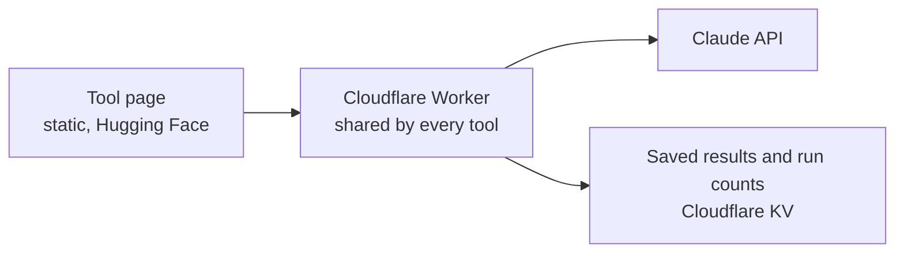

# Marketing AI Tools

Small, working AI tools for B2B marketing teams. Each one solves a single, common problem, can be tried for free in the browser, and keeps its running costs under control.

## AI Search Visibility Check

**[Try it →](https://nazmh-ai-search-visibility.static.hf.space)**

Buyers now ask AI assistants which providers to shortlist, and most marketing teams cannot see whether their brand comes up. This tool asks Claude five typical buyer questions about a category and shows how often each brand is named.

- Each question is asked three times with no web access, to show what the model already knows, and once with live web search, to show what it finds today.
- Brand names are counted with simple rules, so the numbers can be checked. AI is only used to spot other brands the answers mention.
- The page says plainly what the check cannot do: AI answers vary by person, settings and model version, so this is an estimate and a trend, not what any one buyer sees.

## How it is built

**One shared server for every tool.** The Worker holds the API key as an encrypted secret, so it never reaches the browser. It only accepts requests from the tool pages, limits each visitor to two runs a day and all visitors to 20, and saves results for 24 hours so a repeat check is free. A failed run does not use up anyone's allowance.

**Rules first, AI second.** Counting and scoring are done with plain code. The model is used where it adds something, and is told to work only from the facts it is given.

## What is in this repository

| Path | Purpose |
| --- | --- |
| `worker/worker.js` | The shared Cloudflare Worker: limits, cache, API calls and the visibility logic |
| `visibility/index.html` | The AI Search Visibility Check page |

Built by Nazia Hossain. See also [In-Market Signals](https://github.com/nazia-a11y/in-market-signals).
