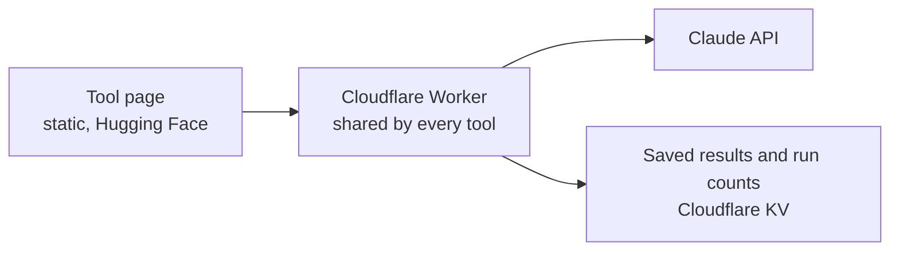

# Marketing AI Tools

Small, working AI tools for B2B marketing teams. Each one solves a single, common problem, can be tried for free in the browser, and keeps its running costs under control.

## AI Search Visibility Check

**[Try it →](https://nazmh-ai-search-visibility.static.hf.space)**

Buyers now ask AI assistants which providers to shortlist, and most marketing teams cannot see whether their brand comes up. This tool asks Claude five typical buyer questions about a category and shows how often each brand is named.

- Each question is asked three times with no web access, to show what the model already knows, and once with live web search, to show what it finds today.
- Brand names are counted with simple rules, so the numbers can be checked. AI is only used to spot other brands the answers mention.
- The page says plainly what the check cannot do: AI answers vary by person, settings and model version, so this is an estimate and a trend, not what any one buyer sees.

## Pipeline Planner

**[Try it →](https://nazmh-pipeline-planner.static.hf.space)**

Marketing plans often start from a budget rather than from the revenue the business needs. This tool works backwards from a revenue target to the leads, opportunities, pipeline and budget required, then asks Claude for a plain-English review.

- Every number is calculated with fixed formulas, in the browser and again on the server. AI never produces a figure.
- A what-if table shows the budget saved by improving each funnel stage by five points, so the real constraint is clear.
- Claude reviews the finished figures only: a summary, the biggest constraint, the risks and the next steps. One short call per review, with no web search, so each costs a fraction of a penny.

## Referral Revenue Calculator

**[Try it →](https://nazmh-referral-calculator.static.hf.space)**

Shows whether a customer referral programme is worth running. From a few numbers a company already knows, it works out the new customers and revenue referrals could bring in over a year, what they would cost, and how that compares with paid channels, then asks Claude for a plain-English review.

- Every number is calculated with fixed formulas. The assumptions come from published benchmarks, with a Cautious setting that uses the low end.
- A what-if table shows which number to improve first, such as how many people sign up from a referral.
- One short Claude call per review, with no web search.

## Global Hiring Planner

**[Try it →](https://nazmh-global-hiring-planner.static.hf.space)**

Helps a company hiring in a new country choose between employer of record and its own local company. Pick one of ten countries, a salary and a hiring plan. It shows what each person really costs with 2026 employer contributions, the recommended route, when to switch, and the cost of each route over 24 months, then asks Claude for a plain-English review.

- Every number is calculated with fixed formulas. Employer contributions come from government sources, and typical costs can be replaced with real quotes.
- Three checks (cost, risk and strategy) decide the route, including country rules that limit employer of record.
- One short Claude call per review, with no web search.

## How it is built

**One shared server for every tool.** The Worker holds the API key as an encrypted secret, so it never reaches the browser. It only accepts requests from the tool pages, gives each tool its own daily limits (for the visibility check, two runs per visitor and 20 in total), and saves results for 24 hours so a repeat check is free. A failed run does not use up anyone's allowance.

**Rules first, AI second.** Counting and scoring are done with plain code. The model is used where it adds something, and is told to work only from the facts it is given.

## What is in this repository

| Path | Purpose |
| --- | --- |
| `worker/worker.js` | The shared Cloudflare Worker: limits, cache, API calls and the logic for each tool |
| `visibility/index.html` | The AI Search Visibility Check page |
| `planner/index.html` | The Pipeline Planner page |
| `referral/index.html` | The Referral Revenue Calculator page |
| `hiring/index.html` | The Global Hiring Planner page |

Built by Nazia Hossain. See also [In-Market Signals](https://github.com/nazia-a11y/in-market-signals).
